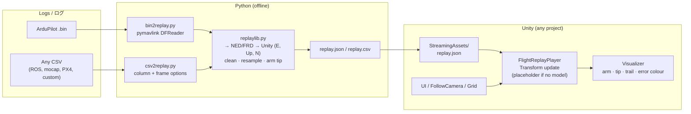

# longarm-drone-replay

**3D replay of drone flight logs in Unity: ArduPilot `.bin` or any CSV, any scene, any object, with optional long-arm tip visualisation.**
ドローンのフライトログ（ArduPilot `.bin` または任意の CSV）を、Unity の任意のシーン・任意の物体で 3D リプレイ再生するツール。長尺アーム先端の表示にも対応。

[](https://doi.org/10.5281/zenodo.24188695)

---

## Overview / 概要

The tool works in two stages:

1. **Python** converts a log into a uniformly resampled replay file. Coordinate frames are converted once, to Unity's left-handed Y-up frame, and the conversion is unit-tested.
2. **Unity** scripts move a `Transform` along the recorded path.

The scripts have **no dependency on any simulator runtime**. They work in an empty project with a cube, in your own environment with your own model, or inside the Hakoniwa (箱庭) drone simulator project that this was first written for.

It was developed for research on arm-tip control of a working drone that carries a 1.5 m rigid, joint-less arm on its nose. The research uses reinforcement learning to correct the RC stick inputs in ArduPilot LOITER mode. The arm is optional: set `--arm-length 0` for a plain vehicle replay.

**Features**

- **Inputs**
  - ArduPilot DataFlash `.bin`, read directly: ATT + XKF1, falling back to NKF1 / POS.
  - Generic CSV: choose the time, position and attitude columns. Position can be NED, ENU (ROS), Unity or lat/lon/alt. Attitude can be Euler or quaternion, in aerospace FRD, ROS FLU or Unity conventions.
- **Cleaning**: drops NaN and non-numeric cells, sorts by time, removes duplicate timestamps, and flags samples inside log gaps (`valid = 0`).
- **Gaps**: optionally removes log gaps (for example disarmed periods) and joins the flights into one replay. Segment numbers and the original log time are kept.
- **Resampling**: linear interpolation for position, quaternion SLERP for attitude (no yaw wrap-around artefacts).
- **Arm**: computes the arm-tip position with the same kinematics as the research.
- **Motors**: exports per-motor output (ArduPilot `RCOU`, with motor→channel mapping read from `SERVOn_FUNCTION`; or `--motor-cols` for CSV). In Unity, RPM and thrust are estimated from your own calibration (RPM = A·PWM + B; T = kT·rpm², kT·ω² or Ct·ρ·n²·D⁴), propellers spin, and thrust arrows are drawn.
- **Attitude error**: colours the vehicle or arm by |desired − actual|, when the desired attitude is available.
- **Unity**:
  - A one-click rig from the menu (`Tools > FlightReplay`).
  - A placeholder body (box, sphere or capsule) when no model is assigned.
  - Play/pause, speed ×0.1–×16, time slider, ±1 s step, jump to the previous/next segment, loop.
  - A tip or body trail, an optional follow camera, and an N/E ground grid.
  - Real-world scenery under the replay, switchable at run time: **Cesium for Unity** (e.g. Google Photorealistic 3D Tiles) or **GSI** terrain and aerial photo (国土地理院 tiles, via `gsi_terrain.py`). The replay is placed at its geodetic origin from the log, with automatic ground snap plus a manual height offset.
  - An on-screen flight-data panel: position, altitude, ground and vertical speed, roll/pitch/yaw, attitude error, arm-tip position.

## System architecture / システム構成



## Repository layout

```
longarm-drone-replay/
├── python/
│   ├── replaylib.py           # frames, cleaning, resampling, arm tip, export (shared)
│   ├── bin2replay.py          # ArduPilot .bin  → replay
│   ├── csv2replay.py          # generic CSV     → replay
│   ├── gsi_terrain.py         # GSI (国土地理院) terrain + photo around a replay
│   └── requirements.txt
├── tests/test_frames.py       # frame-conversion, processing & GSI tests (22)
├── unity/Assets/FlightReplay/
│   ├── Scripts/
│   │   ├── FlightReplayData.cs        # JSON schema
│   │   ├── FlightReplayPlayer.cs      # playback, Transform update, placeholder body
│   │   ├── FlightReplayVisualizer.cs  # arm, tip, trail, error colour
│   │   ├── FlightReplayUI.cs          # playback controls (IMGUI)
│   │   ├── FlightReplayPropellers.cs     (optional: prop spin, RPM / thrust estimate)
│   │   ├── FlightReplayTelemetry.cs      (optional: position, altitude, speed, attitude panel)
│   │   ├── FlightReplayEnvironment.cs    (optional: Cesium / GSI scenery, ground snap)
│   │   ├── FlightReplayFollowCamera.cs   (optional)
│   │   └── FlightReplayGrid.cs           (optional)
│   └── Editor/FlightReplayMenu.cs     # Tools > FlightReplay > Create Replay Rig
├── docs/UNITY_GUIDE_ja.md     # step-by-step guide (generic + Hakoniwa) & troubleshooting
├── CITATION.cff
└── README.md
```

## Quick start / クイックスタート

### 1. Python (3.9+)

```bash
python -m venv .venv
# Windows: .venv\Scripts\activate   /   Linux/WSL: source .venv/bin/activate
pip install -r python/requirements.txt
python tests/test_frames.py                      # every line should print "ok"
```

### 2a. ArduPilot `.bin`

```bash
python python/bin2replay.py 00000042.BIN --dump-fields             # check logged fields first
python python/bin2replay.py 00000042.BIN -o out/flight_replay --skip-gaps   # arm 1.5 m, 50 Hz, armed periods only
```

| Option | Default | Meaning |
|---|---|---|
| `--pos-source` | auto | `xkf1` / `nkf1` / `pos` (auto tries them in this order) |
| `--ekf-core` | 0 | EKF core index (`C` field) for XKF1/NKF1 |
| `--motor-channels` | from log | output channels of motor 1..n (default: read from `SERVOn_FUNCTION`) |
| `--no-motors` | off | do not export motor outputs |

### 2b. Any CSV

```bash
python python/csv2replay.py log.csv --dump-columns                 # list columns & ranges

# aerospace convention (NED, Euler deg), time in microseconds
python python/csv2replay.py log.csv --time-col TimeUS --time-unit us \
  --pos-cols PN,PE,PD --pos-frame ned --euler-cols Roll,Pitch,Yaw --angle-unit deg \
  --att-frame ned_frd -o out/flight_replay

# ROS odometry (ENU / FLU, quaternion x,y,z,w), no arm
python python/csv2replay.py odom.csv --time-col stamp --pos-cols x,y,z --pos-frame enu \
  --quat-cols qx,qy,qz,qw --quat-order xyzw --att-frame enu_flu --arm-length 0 -o out/odom_replay
```

| Option | Values | Meaning |
|---|---|---|
| `--time-col`, `--time-unit` | name; `s` `ms` `us` `ns` | time column and unit |
| `--pos-cols`, `--pos-frame` | 3 names; `ned` `enu` `unity` `geo` | position columns and frame (`geo` = lat, lon [deg], alt [m]) |
| `--euler-cols` / `--quat-cols` | 3 / 4 names | attitude as roll,pitch,yaw (Z-Y-X) or quaternion |
| `--quat-order` | `wxyz` `xyzw` | quaternion component order |
| `--att-frame` | `ned_frd` `enu_flu` `unity` | attitude convention (`unity` for quaternions only) |
| `--angle-unit` | `deg` `rad` | Euler unit |
| `--des-euler-cols` | 3 names | optional desired attitude, for error colouring |
| `--motor-cols`, `--motor-range` | names; min,max | optional motor outputs (motor 1..n) and their range |
| `--geo-origin` | lat,lon,alt | geodetic position of the position-frame origin (for ned/enu/unity input), used to place scenery |

Common options (both scripts):

| Option | Default | Meaning |
|---|---|---|
| `--rate` | 50 | output rate [Hz] |
| `--max-gap` | 0.5 | source gap [s] above which samples are marked `valid=0` |
| `--skip-gaps` | off | remove those gaps and join the valid segments back-to-back (recommended for ArduPilot logs, which are recorded only while armed) |
| `--min-segment` | 1.0 | segments shorter than this [s] are treated as gaps |
| `--arm-length` | 1.5 | arm length along the body nose [m]; `0` = no arm |
| `--arm-mount` | 0,0,0 | arm root from the body centre [m], as forward,right,down (FRD). For example `0,0,-0.08` puts the root 8 cm above the centre. Write `--arm-mount=-0.1,0,0` when the first value is negative |
| `--no-origin-shift` | off | keep the source origin (default: the first valid sample becomes (0,0,0)) |
| `--t-start`, `--t-end` | – | crop by source time [s] |

### 3. Unity (tested with Unity 6.3 LTS, 6000.3.10f1, Windows)

1. Copy `unity/Assets/FlightReplay/` into your project's `Assets/`.
2. Put `flight_replay.json` in `Assets/StreamingAssets/`.
3. Choose **Tools > FlightReplay > Create Replay Rig**. To use your own model, select it first and choose *Create Replay Rig (selected object = vehicle)*.
4. Press Play.

The arm is computed in Unity by default: `FlightReplayPlayer` exposes *Arm Length*, *Arm Mount Local* (x = right, y = up, z = forward) and *Arm Mount Reference*. Drag your model's arm-root object into *Arm Mount Reference* and the tip follows it. Turn off *Arm From Inspector* to use the tip baked into the JSON by `--arm-length` / `--arm-mount` instead.

With no model selected, a placeholder box with a red nose marker is created. You can switch it to a sphere or capsule, and change its size, in `FlightReplayPlayer`. A model of your own must have its nose on local +Z and its pivot at the body centre; otherwise use `Model Euler Offset`.

Full steps, the Hakoniwa example and troubleshooting are in `docs/UNITY_GUIDE_ja.md` (Japanese).

## Coordinate frames / 座標系の変換仕様

Internally every source is first converted to **NED world / FRD body**, then to Unity.

| Frame | x | y | z | Handedness | Used by |
|---|---|---|---|---|---|
| NED world | North | East | Down | right | ArduPilot, PX4 |
| FRD body | Forward | Right | Down | right | ArduPilot, PX4 |
| ENU world | East | North | Up | right | ROS ([REP-103](https://reps.openrobotics.org/rep-0103/)) |
| FLU body | Forward | Left | Up | right | ROS (REP-103) |
| Unity world | East | Up | North | **left** | Unity |
| Unity body | Right | Up | Forward (nose) | **left** | Unity |

**NED/FRD → Unity.** A single permutation is used for both the world frame and the body frame:

$$
P=\begin{pmatrix}0&1&0\\0&0&-1\\1&0&0\end{pmatrix},\quad
\mathbf{v}_\text{Unity}=P\,\mathbf{v}_\text{NED},\quad
R_\text{Unity}=P\,R_\text{NED}\,P^\top,\quad \det P=-1,\ \det R_\text{Unity}=+1 .
$$

`R_Unity` is stored as a quaternion `(x, y, z, w)` that can be passed directly to `new Quaternion(x, y, z, w)`. The equivalent Unity Euler angles (applied in Z → X → Y order) are $(-\theta,\ \psi,\ -\phi)$. Pitch-up raises the nose, a positive yaw turns the nose clockwise seen from above, and a positive roll lowers the right side.

**ENU/FLU → NED/FRD.**

$$
\mathbf{v}_\text{NED}=A\,\mathbf{v}_\text{ENU},\quad
A=\begin{pmatrix}0&1&0\\1&0&0\\0&0&-1\end{pmatrix},\qquad
R_\text{NED,FRD}=A\,R_\text{ENU,FLU}\,B,\quad B=\mathrm{diag}(1,-1,-1).
$$

As a result, ROS yaw 0 (facing East) appears as the nose pointing to Unity +X.

**Euler angles** are intrinsic Z-Y-X: $R=R_z(\psi)R_y(\theta)R_x(\phi)$, applied in the frame chosen by `--att-frame`.

**Arm tip.** The arm is rigid and massless, and points along the nose (FRD +X) from its root $\mathbf{m}$, given in the body frame (`--arm-mount`):

$$
\mathbf{p}_\text{tip}=\mathbf{p}+R\,\bigl(\mathbf{m}+(L,0,0)^\top\bigr)_\text{FRD}.
$$

With $\mathbf{m}=\mathbf{0}$ (the default, an arm on the roll axis) this reduces to the kinematics used in the research:

$$
\mathbf{p}_\text{tip,NEU}=\mathbf{p}+\bigl(L\cos\psi\cos\theta,\ L\sin\psi\cos\theta,\ L\sin\theta\bigr).
$$

A root above the centre ($m_D<0$) raises the tip by $-m_D\cos\theta$ and moves it back by $-m_D\sin\theta$ when pitched up.

**Geodetic input** (`POS`, or `--pos-frame geo`) is converted to local NED around the first sample with a flat-earth approximation (R = 6 378 137 m). This is adequate over a few hundred metres.

**ArduPilot fields.** `XKF1.PN/PE/PD` is the EKF3 position relative to the EKF origin [m, NED], and `ATT.Roll/Pitch/Yaw` and `ATT.DesRoll/DesPitch/DesYaw` are in degrees ([ArduPilot onboard log messages](https://ardupilot.org/copter/docs/logmessages.html)). Field names can differ between firmware versions, so run `--dump-fields` first.

All of the above is checked in `tests/test_frames.py`. The checks include:

- the right-hand/left-hand flip
- the yaw, pitch and roll directions
- Unity Euler equivalence
- the arm-tip formula
- yaw wrap-around in SLERP
- gap flagging
- the same flight written as NED/Euler, ROS ENU/FLU quaternion and Unity quaternion giving identical output

## Replay file format (v1.0)

`meta`: `source_file`, `position_source`, `rate_hz`, `max_gap_s`, `arm_length_m`, `arm_mount_frd`, `t0_boot_s`, `skip_gaps`, `motor_count`, `motor_channels`, `motor_channel_source`, `motor_source`, `pwm_min`, `pwm_max`, `frame_class`, `frame_type`, `geo_origin` (lat, lon, alt of Unity (0,0,0)), `frame`, `body_frame`, `mapping`, `n_frames`, `duration_s`, `origin_unity`, `n_segments`, `segments[]` (`seg`, `t_start`, `t_end`, `t_src_start`, `t_src_end`).

`frames[]` (and the CSV columns):

| key | unit | description |
|---|---|---|
| `t` | s | time from the first frame |
| `px, py, pz` | m | body position, Unity world |
| `qx, qy, qz, qw` | – | body rotation, Unity world |
| `tx, ty, tz` | m | arm-tip position, Unity world (= body position when `arm_length_m` is 0) |
| `att_err_deg` | deg | attitude error, −1 = unavailable |
| `valid` | 0/1 | 0 = inside a source gap > `max_gap_s` |
| `seg` | – | segment index (continuous valid run), −1 = inside a gap |
| `t_src` | s | source time (time since boot for `.bin`) |
| `pwm[]` | µs (or source unit) | output of motor 1..n (only when motor data is exported). JSON only; in the CSV these are the columns `pwm1..pwmN` |

With `--skip-gaps`, `t` is continuous and uniformly spaced while `t_src` jumps at segment boundaries. The Unity player never interpolates across a segment boundary, and resets the trail there.

## Real-world scenery

`bin2replay.py` writes `meta.geo_origin`, the latitude, longitude and altitude of Unity (0,0,0), taken from `POS` at the first frame. `FlightReplayEnvironment` places the scenery there:

- **Cesium**: install Cesium for Unity from the scoped registry (`https://unity.pkg.cesium.com`, scope `com.cesium.unity`), connect to Cesium ion, and add *Google Photorealistic 3D Tiles* from *Quick Add*. Turn on *Show Credits On Screen* on the tileset, which Google Maps Platform terms require. Keep your own camera (do not add Cesium's Dynamic Camera), and raise its far clipping plane. The script then sets the origin of the `CesiumGeoreference` with `SetOriginLongitudeLatitudeHeight(lon, lat, height)` (height above the ellipsoid). Cesium's Unity frame is East-Up-North, the same as the replay. Cesium for Unity is accessed by reflection, so the scripts compile without it.
- **GSI**: `python python/gsi_terrain.py out/flight_replay.json --out-dir Assets/StreamingAssets/gsi` downloads GSI elevation tiles (`dem5a_png` z15, falling back to `dem5b_png` / `dem_png`) and the seamless aerial photo. The height encoding is h = (2¹⁶R + 2⁸G + B)·0.01 m, with (128,0,0) = no data. The script writes a height grid in replay coordinates plus a cropped photo, which Unity turns into a mesh at run time. Credit the source as required by the GSI terms (`ATTRIBUTION.txt`).
- **Height**: the map datum (ellipsoidal for Cesium, orthometric for GSI) and the log altitude rarely agree. *Auto Snap To Ground* ray-casts under the first frame and lifts or lowers the replay so the body sits *Ground Clearance* above the ground. *Manual Height Offset* is added on top.

## Using it inside Hakoniwa (箱庭)

In the Hakoniwa drone simulator, the Unity project (`hakoniwa-unity-drone`, WebAvatar scene) normally receives the vehicle pose from `hakoniwa-webserver` over WebSocket. To replay a log instead:

1. Duplicate the scene.
2. Disable the `DroneAvatarWeb` component, which writes the drone `Transform` from the WebSocket stream.
3. Use *Create Replay Rig (selected object = vehicle)* on the drone model.

The Hakoniwa core, SITL and the web server do not need to be running. See section B of the guide.

## Limitations

- The arm is drawn as rigid and massless, matching the simulation model of the research. Bending of the arm is not represented.
- The replay shows the logged estimate (for example the EKF output), not ground truth.
- RPM and thrust are estimates from the **commanded** motor output and your calibration. ArduPilot `RCOU` is not measured RPM, and battery sag and load are not modelled.
- Scenery alignment depends on the GPS-based geo origin (metre-level error) and on the ground snap.
- Real-time streaming (Hakoniwa PDU / WebSocket) is not implemented. The replay data already holds position, quaternion and tip position, so it can be reused for streaming later.

## Citation / 引用

If you use this software, please cite it (see also `CITATION.cff`). The DOI below always resolves to the latest version.

```bibtex
@software{uchiumi_longarm_drone_replay,
  author    = {Uchiumi, Sho},
  title     = {longarm-drone-replay: 3D replay of drone flight logs in Unity with long-arm tip visualisation},
  year      = {2026},
  version   = {v0.1.1},
  publisher = {Zenodo},
  doi       = {10.5281/zenodo.24188695},
  url       = {https://doi.org/10.5281/zenodo.24188695}
}
```

### Publishing to Zenodo / researchmap

1. Make the GitHub repository public (the Zenodo GitHub integration archives public repositories).
2. On Zenodo, sign in with GitHub and switch the repository on in the GitHub integration settings (https://help.zenodo.org/docs/github/enable-repository/). Do this **before** creating the release: Zenodo cannot reserve a DOI for a GitHub release in advance.
3. Create a GitHub Release (e.g. `v0.1.0`). Zenodo archives it and issues a DOI.
4. Put the DOI into the badge, the BibTeX above and `CITATION.cff`.
5. Register it on researchmap under Works (作品等) with the title, the DOI URL and the release date.

## Related software

- Hakoniwa (箱庭), TOPPERS/Hakoniwa WG and Hakoniwa Lab: https://toppers.github.io/hakoniwa/ (e.g. [hakoniwa-drone-core](https://github.com/toppers/hakoniwa-drone-core), [hakoniwa-webserver](https://github.com/toppers/hakoniwa-webserver))
- ArduPilot: https://ardupilot.org ([onboard log messages](https://ardupilot.org/copter/docs/logmessages.html))
- pymavlink: https://github.com/ArduPilot/pymavlink
- Cesium for Unity: https://github.com/CesiumGS/cesium-unity
- 地理院タイル（国土地理院）: https://maps.gsi.go.jp/development/ichiran.html

## License

MIT License. See [LICENSE](LICENSE).

Map data are **not** part of this repository. If you show GSI terrain or Cesium / Google Photorealistic 3D Tiles in images or videos, follow the providers' terms and keep their attribution (GSI: `ATTRIBUTION.txt`; Cesium: *Show Credits On Screen*).

## Status

| Item | Status |
|---|---|
| Python conversion (`.bin`, CSV), frame conversion | unit-tested (22 tests) |
| Unity replay, propellers, telemetry, GSI scenery | used with Unity 6000.3.10f1 on Windows 11 |
| Cesium scenery | implemented; not yet verified on the author's PC (Windows Smart App Control blocks the unsigned Cesium native plugin) |
| Real-time streaming (Hakoniwa PDU / WebSocket) | not implemented |
